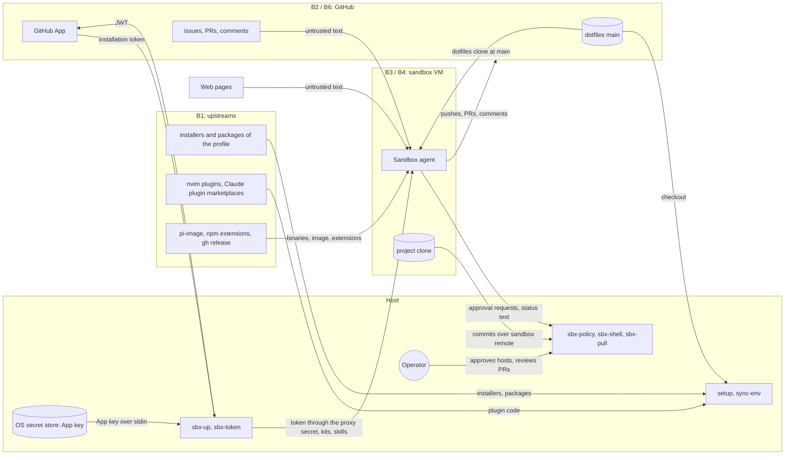

# Threat model: dotfiles

**Kind**: product
**Last reviewed**: 2026-10-19

## Scope

This model covers what every profile shares: the commands, the dotfiles, the sandbox kits, and the GitHub side. It also covers the Docker Sandboxes that a host runs. "The host" is the machine where the operator runs the commands.

Each profile has its own model, `profile-<name>.md`, for what only that profile installs and does. A profile model refers to the IDs in this model.

- **Commands**: `sync-env`, `setup`, `doctor`, `pull-nvim`, `sync-skills`, `sbx-up`, `sbx-shell`, `sbx-pull`, `sbx-policy`, `sbx-token`, and the scripts in `env/.local/bin`. Also the shared `lib/` that they source.
- **The profile mechanism**: `lib/profile.sh`, and how `setup`, `sync-env`, and `doctor` read a profile's steps, manifest, and doctor checks. The content of each profile is in its own model.
- **The dotfiles** in `env/` that a manifest copies into `$HOME`, which include the agent skills in `env/.agents/`.
- **The sandbox kits** in `sbx/kits/` (`my-claude`, `pi-ailo`, and the `dotfiles` and `agent-skills` mixins), and what they run inside a sandbox.
- **The GitHub side**: the `domtriola/dotfiles` repository with its `main` ruleset, and the GitHub App that `sbx-token` mints tokens from.

Out of scope:

- **What one profile installs and does**: its setup steps, its downloads, its doctor checks, and its machine. These are in the profile's model. [profile-dev-mac.md](profile-dev-mac.md) covers `dev-mac`. `dev-linux`, `infosec-qubes`, and `ai-server` have no model yet. `sbx-linux` is in scope here only as what the `dotfiles` mixin runs inside a sandbox.
- **The internals of Docker Sandboxes** (the daemon, the proxy, the firewall, the VM) and of the upstream `claude` kit that `my-claude` extends. The model relies on them. See [Assumptions](#assumptions).
- **A hostile repository that the operator clones and opens** (for example, an executable `.ready-tmux` that `tmux-sessionizer` runs). The operator chose to keep this adversary out of scope. A file of this kind that a *sandbox* writes is in scope as T10.
- **Physical access** to a host, and other local users: every host has a single user.

## Assets

| ID  | Asset | Why it matters | Worst outcome |
| --- | ----- | -------------- | ------------- |
| A1 | The GitHub App private key, in the host's OS secret store (the Keychain on macOS, Secret Service on Linux) | It mints a token for every repository that the App is installed on. | An attacker pushes code to every repository of the owner. |
| A2 | The installation tokens that `sbx-token` mints for each sandbox | A sandbox agent writes to GitHub with them. | An attacker pushes to, or merges into, the repositories in the token's scope. |
| A3 | The `main` branch of `domtriola/dotfiles` | Every sandbox clones it at start, and `sync-env` and `setup` install it on every host. | A malicious change runs on every host and in every new sandbox. |
| A4 | The operator's own credentials: the `gh` token and the SSH key | They authenticate and sign as the operator. | Impersonation of the operator, and commits signed in their name. |
| A5 | The integrity of the host user account (the OS secret store, `~/src`, shell startup files) | Everything above sits on it. | Code runs as the operator on the host. |
| A6 | The sandbox boundary | It is what lets an agent work without the operator approving each action. | A sandbox agent runs code on the host. |
| A7 | Project source and data inside a sandbox | Private repositories are worked on there. | A hijacked agent exfiltrates them. |

## Actors

- **Operator**: the one person who uses each host and runs the commands. Trusted, and an administrator of each host.
- **Sandbox agent**: Claude Code in `my-claude`, or pi in `pi-ailo`, inside a sandbox. It has a shell, git, `gh`, and a scoped GitHub token through the proxy. The model treats it as possibly hijacked, because it reads untrusted content.
- **Host Claude Code**: Claude Code on the host, outside a sandbox. What it may do depends on the profile. See the profile's model.
- **GitHub**: hosts the repositories, the ruleset, and the App. Trusted.
- **Docker Sandboxes**: the VM, the firewall, the approval queue, and the proxy that injects the `github` secret. Trusted.
- **Renovate**: a GitHub App that opens PRs to bump the pinned versions.
- **Adversary: compromised upstream.** A malicious or hijacked maintainer, or the infrastructure, of something that setup or a kit downloads (Homebrew formulae and casks, installer scripts, npm packages, nvim plugins, Claude Code plugin marketplaces, container images). This adversary can publish code that a host or a sandbox runs.
- **Adversary: prompt injector.** Anyone who can write text that an agent reads: an issue, a comment, a PR, a web page, or a file in another repository. `domtriola/dotfiles` is public, so this is anyone with a GitHub account. This adversary can put instructions in front of the sandbox agent.
- **Adversary: network attacker.** Someone on the network path between a host and an upstream. This adversary can read and change traffic that is not encrypted.

## Entry points

- **CLI arguments** of every command in scope. The profile name is checked against a fixed list (`lib/profile.sh`).
- **Files that the commands read**:
  - `profiles/<profile>/env.manifest`
  - `~/.config/dotfiles/checkout` and `~/.config/dotfiles/profile`, which pick the code that the installed commands source
  - the sync record in `~/.local/state/dotfiles/synced`
  - `.sbx.json` at a project root
  - `~/.config/sbx/kit.args`
  - `~/.config/sbx-token/config.json`
  - `env/.agents/skills-local/`
  - `.ready-tmux` in the current directory (`env/.local/bin/ready-tmux`)
- **Environment**: `DOTFILES_DIR`, `DOTFILES_PROFILE`, `SBX_UP_DOTFILES`, `SBX_KIT_ARGS_FILE`, `SBX_TOKEN_BIN`, `SBX_TOKEN_STORE`, `PROMPT_TTY`, `SSH_KEY_PROT`.
- **Downloads during setup**: each profile's model lists its own. The dotfiles add these on every profile that copies them:
  - lazy.nvim and its plugins (`env/.config/nvim`).
  - The Claude Code plugin marketplaces (`env/.claude/settings.json`).
- **Downloads inside a sandbox**:
  - The `gh` release (`my-claude`).
  - The `pi-image` container and the npm extensions (`pi-ailo`).
  - The dotfiles clone at `main`, and apt packages (`dotfiles` mixin).
- **Output from a sandbox to the host**:
  - Pending network approvals (`sbx policy approval ls`), which `sbx-policy` reads.
  - The kit status and log files, which `sbx-shell` reads.
  - The `sandbox-<name>` git remote, which `sbx-pull` fetches.
  - The host worktree, in direct mode only.
- **GitHub API responses**, which `sbx-token` reads.
- **Untrusted text that the sandbox agent reads**: issues, comments, PRs, web pages, and other repositories.
- **Model output**: the sandbox agent's tool calls, and the JSON that Claude Code sends to `statusline.sh`.

## Trust boundaries

| ID  | Boundary | Between | Control at the boundary |
| --- | -------- | ------- | ----------------------- |
| B1 | Upstreams to a host | Package registries, installer scripts, and plugin sources, and a host | HTTPS (I1). Package-manager signatures and digests. Renovate and a 7-day release age where they apply. |
| B2 | `main` to every machine | The `domtriola/dotfiles` repository, and the hosts and sandboxes that install it | The `main` ruleset (I2). |
| B3 | Sandbox to host | A sandbox VM and the host that runs it | VM isolation. A clone by default (I3, I4). Operator approval of network destinations (I5). Fast-forward-only `sbx-pull`. |
| B4 | Host to sandbox | The host and the secrets, kits, and skills that it gives a sandbox | The token reaches the sandbox only through the proxy secret. A scope ceiling on the token (I6, I7). |
| B5 | Untrusted text to the agent | Issues, PRs, web pages, and other repositories, and the sandbox agent's context | None in the prompt. The token scope and the firewall limit what follows. |
| B6 | Agent to GitHub | The sandbox agent and GitHub, through the proxy-injected token | The token scope (I6) and the `main` ruleset (I2). |
| B7 | Key handling on the host | `sbx-token`, the OS secret store, the GitHub API, and the sbx daemon | Secrets passed off the command line (I8). Installation check (I9). |

## Data flows

## Threats

| ID  | STRIDE | Threat | Boundary | Likelihood | Impact | Status | Mitigation |
| --- | ------ | ------ | -------- | ---------- | ------ | ------ | ---------- |
| T3 | T | An nvim plugin, a Mason tool, or a treesitter parser is compromised. lazy.nvim follows branch heads on update, and `lazy-lock.json` does not cover Mason or treesitter. | B1 | low | high | accepted | `lazy-lock.json` pins plugin commits until the next update. |
| T4 | T | A Claude Code plugin from a third-party marketplace in `env/.claude/settings.json` is changed. The marketplaces have no pinned ref. | B1 | low | high | accepted | On `dev-mac`, the managed settings deny host Claude Code every tool (`dev-mac-I1`). |
| T5 | S | A network attacker serves a different file in place of a download. | B1 | low | high | mitigated | I1 |
| T6 | T | A malicious change on `main` reaches every new sandbox (the `dotfiles` mixin clones `main` without a pin) and every host at its next `sync-env` or `setup`. | B2 | low | high | mitigated | I2 |
| T7 | E | A sandbox agent merges its own PR. Its token has `contents` and `pull_requests` write access, and "never merge" is only an instruction in the prompt. | B6 | medium | high | mitigated | I2 |
| T8 | I | `pull-nvim` copies all of `~/.config/nvim` into the repository with no prompt, so a secret file there can be committed to the public repository. | B2 | low | medium | accepted | None. |
| T9 | E | A sandbox that mounts the dotfiles worktree edits code that the host runs, such as `sync-skills` (run by `sbx-up`) and `lib/style.sh` (sourced by `sbx-policy` and `sbx-shell`). | B3 | medium | high | mitigated | I3, I4 |
| T10 | E | A sandbox that mounts any project worktree writes `.git/hooks`, `.git/config`, `.ready-tmux`, or `.sbx.json`, and the host runs or reads that file later. | B3 | medium | high | mitigated | I4 |
| T11 | E | A sandbox edits the host's `.sbx.json` to choose any kit by path or URL, or to add repositories to the next token. | B3 | low | high | mitigated | I4. A change that reaches the host through `sbx-pull` is T12. |
| T12 | T | `sbx-pull` fast-forwards the operator's branch to sandbox commits that it does not verify. It lists the commits, but not their diff. | B3 | low | medium | accepted | Fast-forward only, unless `--rebase`. |
| T13 | T | `sbx-policy` and `sbx-shell` print text from the sandbox (approval titles, kit status, log lines) to the host terminal, with no filter for escape sequences. | B3 | low | low | accepted | None. |
| T14 | S | An approval that the operator gives for one sandbox answers the request of another sandbox. | B3 | low | medium | mitigated | I5 |
| T15 | I | A hijacked agent gets the operator to approve an exfiltration host (`sbx-policy approve <sandbox> evil.example`), or the operator runs `approve --all` without reading the list. | B3 | low | medium | accepted | The operator types each host. |
| T16 | E | A sandbox gets a token that reaches more repositories or permissions than its project needs, or falls back to the operator's `gh` token. | B4 | low | high | mitigated | I6, I7 |
| T17 | I | The App private key, a JWT, or an installation token shows in a process list or a log. | B7 | low | high | mitigated | I8 |
| T18 | I | `sbx-token import-key` leaves the original `.pem` file on disk. It only tells the operator to delete it. | B7 | low | high | accepted | None. |
| T19 | S | Another account installs the public App, and a token is minted for that account by mistake. | B7 | low | medium | mitigated | I9 |
| T20 | T | Untracked skills in `env/.agents/skills-local/` override tracked skills with the same name, and reach the host and every sandbox with no review. | B4 | low | medium | accepted | None. |
| T21 | T | `pi-image:latest` or a pi npm extension, both of which `pi-ailo` fetches without a pin, is compromised. | B1 | low | medium | accepted | It runs only inside the sandbox. |
| T22 | T, E | Prompt injection in an issue, a comment, or a web page makes the agent push malicious code, post content, or misuse its token. `implement` runs through to a PR without asking, and no skill tells the agent to treat this text as data. | B5 | medium | medium | accepted | I2 and I6 limit what follows. |
| T23 | I | A hijacked agent sends project source to a host that it chooses. | B5 | low | medium | mitigated | I10. The residual is T15. |
| T24 | E | `triage` checks out and runs the code of an external PR. | B5 | low | high | mitigated | I11 |
| T26 | T | Crafted fields in the JSON that `statusline.sh` reads run code through bash arithmetic, or send escape sequences. | B5 | low | low | accepted | The input comes only from Claude Code. |
| T27 | T | A manifest destination of `$HOME/..`, or an empty `$HOME`, makes `sync-env` delete or write files outside `$HOME`. | B2 | low | medium | mitigated | I13 |
| T28 | T | With no TTY, or with `--yes`, `sync-env` overwrites drift with only a warning, and it deletes the operator's own files inside the trees that it replaces. | B2 | low | low | accepted | A drift prompt when a TTY is present. |
| T29 | T | The `gh` release that `my-claude` downloads is replaced. | B1 | low | high | mitigated | I14 |

STRIDE categories that have no threat above:

- **Repudiation (B3, B6)**: there is one operator. GitHub attributes each agent action to the App, and commits carry a `Co-Authored-By` line.
- **Repudiation (B1, B2, B4, B5, B7)**: no action across these boundaries needs to be attributed to a person other than the operator.
- **Denial of service (B1, B2)**: an upstream outage delays setup. It does not harm an asset.
- **Denial of service (B3, B4)**: sbx caps the memory of a sandbox (`memory` in `.sbx.json`), and the operator can remove it.
- **Denial of service (B5, B6, B7)**: GitHub rate limits are the worst case. They block work, not assets.
- **Spoofing (B5)**: the agent has no identity check to bypass. Text from an injector is T22.
- **Information disclosure (B2)**: aside from T8, `main` holds no secrets.

## Security invariants

| ID  | Invariant | Enforced in | Mitigates |
| --- | --------- | ----------- | --------- |
| I1 | Every URL that a setup step, a kit, or a command downloads from uses `https://`. The one exception is the `pi-ailo` model server URL, which goes over the encrypted NetBird overlay. | `profiles/*/*`, `sbx/kits/*/spec.yaml` | T5 |
| I2 | The `main` ruleset of `domtriola/dotfiles` requires a PR with at least 1 approving review, blocks force pushes and deletion, and has no bypass actor other than the repository admin role. Check it with `gh api repos/domtriola/dotfiles/rulesets`. | GitHub ruleset "Main protection" | T6, T7 |
| I3 | The `.sbx.json` of this repository sets `"clone": true`. | `.sbx.json` | T9 |
| I4 | `sbx-up` passes `--clone` for every project inside git, unless that project's `.sbx.json` sets `"clone": false`. | `sbx-up` (`config_load`) | T9, T10, T11 |
| I5 | `sbx-policy` answers a pending approval only when its sandbox equals the sandbox that the operator named, and its destination equals a host that the operator typed (or that host with a port). | `sbx-policy` (`lib/approvals`) | T14 |
| I6 | Every token that `sbx-token` mints names explicit repositories of one owner, each matching `^[A-Za-z0-9_.-]+/[A-Za-z0-9_.-]+$`. Its permissions stay within the ceiling (`contents`, `pull_requests`, and `issues` write; `actions` and `metadata` read; never `workflows`), and the ceiling is checked before any GitHub call. | `sbx-token` (`lib/scope`) | T16, T22 |
| I7 | When a token cannot be minted, `sbx-up` stops before it removes the old sandbox. It never falls back to the `gh` token or a broader one. | `sbx-up` (`lib/github`), `sbx-token` | T16 |
| I8 | `sbx-token` never puts the App private key, a JWT, or an installation token on a command line or in a log. It passes them through stdin, a file descriptor, or the `--command` that sbx runs. | `sbx-token` (`lib/store`, `lib/github`, `lib/mint`) | T17 |
| I9 | `sbx-token check` exits non-zero when the App has an installation on an account that the operator did not expect. | `sbx-token` (`lib/check`) | T19 |
| I10 | A kit's network allow list names only the hosts that the kit needs. Every other destination needs the operator's approval. | `sbx/kits/*/spec.yaml` | T23 |
| I11 | `docs/agents/issue-tracker.md` keeps "PRs as a request surface: no", so `triage` never checks out or runs an external PR. | `docs/agents/issue-tracker.md` | T24 |
| I13 | `read_manifest` refuses an empty `$HOME` or `/` as `$HOME`, and every destination that is outside `$HOME` or holds a `..` segment, before `sync-env` copies anything. | `lib/manifest.sh` | T27 |
| I14 | A binary that a kit downloads by URL has a pinned version, and it is checked against a SHA-256 before it is installed. | `sbx/kits/sandboxes/my-claude/spec.yaml` | T29 |

## Accepted risks

| Threat | Reason | Accepted by | Date | Revisit when |
| ------ | ------ | ----------- | ---- | ------------ |
| T3, T4, T21 | Every download comes over HTTPS from the vendor's own source. Package managers check signatures or digests, and Renovate and the 7-day release age apply where they can. On personal machines, pinning every installer costs more to maintain than it reduces the risk. | Dominick Triola | 2026-10-12 | An upstream has a security incident. |
| T8 | The operator reviews every commit, and sees a new file in `git status` before it is committed. | Dominick Triola | 2026-10-12 | Commits are made without a review. |
| T12 | Sandbox commits then go through a PR that the operator reviews (I2). | Dominick Triola | 2026-10-12 | Code from a sandbox runs on the host before it is reviewed. |
| T13 | Modern terminals block the dangerous escape sequences. The worst case is changed or hidden text. | Dominick Triola | 2026-10-12 | The terminal changes. |
| T15 | The operator reads each host before approving it. | Dominick Triola | 2026-10-12 | Another person approves requests. |
| T18 | The operator deletes the `.pem` file during bootstrap, as the steps say. | Dominick Triola | 2026-10-12 | The App key is rotated or imported again. |
| T20 | Only the operator can write `skills-local`. | Dominick Triola | 2026-10-12 | Another person uses the host. |
| T22 | With I2 in place, injected code reaches `main` only through a PR that the operator reviews, and the token scope (I6) and the firewall (I10) limit what else the agent can do. A rule in the prompt alone adds little. | Dominick Triola | 2026-10-12 | The ruleset loses its review requirement, or the agent gets a broader token. |
| T26 | The input comes only from Claude Code. | Dominick Triola | 2026-10-12 | Another program writes to the statusline. |
| T28 | This is data loss, not an attack path, and a TTY run asks first. | Dominick Triola | 2026-10-12 | `sync-env` runs unattended. |

## Assumptions

- Every host has one user, the operator. Each profile's model records how its disk is encrypted.
- The GitHub account `domtriola` uses two-factor authentication.
- The Renovate GitHub App is installed on `domtriola/dotfiles`.
- Docker Sandboxes isolates a sandbox VM from the host. What crosses are the worktree (direct mode), a read-only source mount (clone mode), the `sandbox-<name>` git remote, and the proxy. The proxy injects the `github` secret and enforces the network policy.
- The upstream `claude` kit that `my-claude` extends mounts no other host path.
- The GitHub App holds no permission beyond the `sbx-token` ceiling, and GitHub enforces that limit on the server side.
- The ai-server that `pi-ailo` talks to is reachable only over the NetBird overlay.
- No compliance or data-handling obligations apply.
