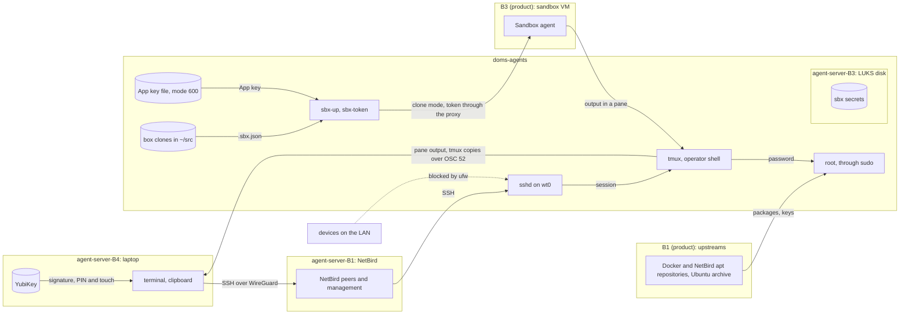

# Threat model: the agent-server profile

**Kind**: feature
**Product model**: [product.md](product.md)
**Origin**: #109
**Last reviewed**: 2026-10-21

## Scope

This model covers what only the `agent-server` profile installs and does. The profile runs on drive 1 of the Framework Desktop (hostname `doms-agents`): a headless Ubuntu Server that is always on, where about 8 sandboxes run for long periods while the operator is away. The commands, the dotfiles, the sandbox kits, the GitHub side, and the sandboxes are in the [product model](product.md). In the product model, "the host" is the box for this profile.

- **The `agent-server` setup steps** (`profiles/agent-server/`), and what they download: the Docker repository (for `sbx`) and the NetBird repository.
- **The SSH server** on the box, and the operator's SSH sessions from the laptop into the box's tmux.
- **NetBird** on the box, which is the only network path to the SSH server.
- **The App key file**: `sbx-token` with `SBX_TOKEN_STORE=file`, which only this profile uses.
- **`sudo`** with the operator's password.
- **The box's clones** in `~/src`, from which the operator starts sandboxes with `sbx-up`.
- **Unattended work**: security updates without a reboot, no sleep, and agents that run while the operator is away.
- **Its `env.manifest`** and its doctor checks.
- **The box's hardware** (LUKS, the IOMMU, the firmware settings), as far as the profile depends on them.

Out of scope:

- **Everything in the product model.** This model adds to it, and does not repeat it.
- **Drive 2** (`ai-server`). It is a different system, which only shares the firmware settings with this drive.
- **The internals of NetBird** (the management service, the relays, WireGuard). The model relies on them. See [Assumptions](#assumptions).

## Assets

| ID  | Asset | Why it matters | Worst outcome |
| --- | ----- | -------------- | ------------- |
| agent-server-A1 | The box's own private key of the GitHub App (product A1), in a file under `~/.config/sbx-token/` | It mints the tokens for the box's sandboxes. The Mac has a different key of the same App. | An attacker mints tokens for every repository that the App is installed on, until the operator revokes the box's key. |
| agent-server-A2 | Root on the box | It controls every sandbox, the key file, and the disk. | An attacker owns the box and every sandbox on it. |
| agent-server-A3 | The data on the box's disk: the clones, the sandboxes, and the `sbx` secrets (the Claude login), which `sbx` keeps on disk because the box has no Secret Service | Private source, and credentials. | A stolen drive or box shows the source and the credentials. |
| agent-server-A4 | The laptop that connects to the box (its clipboard, its terminal, and its SSH agent) | The operator works on the box from it. | Text from a sandbox runs as a command on the laptop. |
| agent-server-A5 | The availability of the box | Agents run for hours while the operator is away. | The box stops at the LUKS prompt, sleeps, or cannot push, and the work stops until the operator is home. |

Product A4 (the operator's SSH key) is the YubiKey key (`ed25519-sk`) on this profile.

## Actors

- **Operator**: connects over SSH from the laptop, through NetBird, and works in the box's tmux. Types the `sudo` password, and the LUKS passphrase at the box's keyboard.
- **Adversary: device on the LAN.** A guest's device, or a hijacked IoT device, on the operator's home network. It can send traffic to the box's LAN address.
- **Adversary: NetBird peer.** A peer on the operator's NetBird network that the operator does not control: a peer in another group when the policy is wrong, or a peer that an attacker adds through the NetBird account.
- **Adversary: person at the operator's home.** Can touch the running box: its keyboard, its USB and USB4 ports, its firmware setup, and its power cable. Can also carry it away.
- **Adversary: thief.** Takes the box or a drive. Taking it cuts the power.
- **Adversary: process that runs as the operator.** For example, a sandbox escape, or a compromised package. It can read every file that the operator can read.
- **NetBird**: the management service and the client daemon, which runs as root. Trusted.

The other actors are in the product model.

## Entry points

- **The SSH server** (port 22, on the NetBird interface `wt0` only).
- **The NetBird client**: its traffic from peers, and the configuration that the management service sends to it.
- **The box's console**: the keyboard, the LUKS prompt, and the firmware setup.
- **The USB and USB4 ports.**
- **Downloads during setup**:
  - The Docker repository key and `docker-sbx` (`22_sandboxes`).
  - The NetBird repository key and the `netbird` package (`25_network`).
  - Ubuntu packages, also from unattended upgrades.
- **The key file** `~/.config/sbx-token/`, which `sbx-token` reads.
- **`.sbx.json`** in a box clone, which `sbx-up` reads.
- **The output of the box's tmux**, which goes to the laptop's terminal over SSH.

The other entry points are in the product model.

## Trust boundaries

| ID  | Boundary | Between | Control at the boundary |
| --- | -------- | ------- | ----------------------- |
| agent-server-B1 | Network to the SSH server | The LAN and the NetBird peers, and `sshd` on the box | ufw allows 22/tcp only on `wt0` (agent-server-I2). The NetBird policy. Only `sk-` keys with `verify-required` (agent-server-I1). |
| agent-server-B2 | Operator's user to root | A process that runs as the operator, and root | The `sudo` password (agent-server-I4). |
| agent-server-B3 | Physical access to the box | A person who touches the box, and its disk and memory | LUKS (agent-server-I7). The IOMMU (agent-server-I6). |
| agent-server-B4 | Box to laptop | The box's tmux and SSH session, and the laptop's terminal, clipboard, and SSH agent | tmux `set-clipboard external` (agent-server-I10). No agent forwarding (agent-server-I3). |

Its other threats cross product boundaries B1 (upstreams to a host), B3 (sandbox to host), and B7 (key handling on the host).

## Data flows

## Threats

| ID  | STRIDE | Threat | Boundary | Likelihood | Impact | Status | Mitigation |
| --- | ------ | ------ | -------- | ---------- | ------ | ------ | ---------- |
| agent-server-T1 | S | Someone logs in over SSH with a password, a key copied from a laptop, or a key with no PIN and touch. | agent-server-B1 | low | high | mitigated | agent-server-I1 |
| agent-server-T2 | E | A device on the LAN exploits a bug in `sshd` before login. | agent-server-B1 | low | high | mitigated | agent-server-I2 |
| agent-server-T3 | S, E | A NetBird peer that the operator does not control reaches `sshd`: a wrong dashboard policy, or a peer that an attacker adds through the NetBird account. | agent-server-B1 | low | high | accepted | agent-server-I1. The NetBird policy (see [Assumptions](#assumptions)). |
| agent-server-T4 | S | NetBird's own SSH server lets a peer in through NetBird's authorization, and not through `sshd` and the YubiKey. | agent-server-B1 | low | high | mitigated | agent-server-I9 |
| agent-server-T5 | E | A process that runs as the operator gets root with no password. | agent-server-B2 | medium | high | mitigated | agent-server-I4 |
| agent-server-T6 | E | A process that runs as the operator (for example, through a changed `.bashrc`) captures the `sudo` password when the operator types it. | agent-server-B2 | low | high | accepted | None. |
| agent-server-T7 | E | A root process on the box uses the laptop's SSH agent, which the laptop forwards. | agent-server-B4 | low | high | mitigated | agent-server-I3. The laptop config sets no `ForwardAgent`. |
| agent-server-T8 | I | Another local user, or a moment of a wider mode during a write, reads the App key file. | B7 | low | high | mitigated | agent-server-I5 |
| agent-server-T9 | I | A process that runs as the operator reads the App key file or the `sbx` secrets, which no keychain protects. | B7 | low | high | accepted | agent-server-I5 limits it to the operator's user. Product I6 limits each token. |
| agent-server-T10 | D | The box and the Mac use the same App. A leak of the App, not of one key, means that the operator revokes the access of both. | B7 | low | medium | accepted | Each machine has its own private key, so a leak of one key file revokes only that key. |
| agent-server-T11 | I, T | A device on a USB4 port reads or writes the memory of the running box (DMA). | agent-server-B3 | low | high | mitigated | agent-server-I6 |
| agent-server-T12 | I | A thief reads the disk of a stolen box or drive. | agent-server-B3 | medium | high | mitigated | agent-server-I7 |
| agent-server-T13 | T, I, E | A person at the operator's home attacks the running box: the console, the memory, boot from USB, or the firmware settings. No firmware password is set. | agent-server-B3 | low | high | accepted | agent-server-I4 and agent-server-I6 cover part of it. |
| agent-server-T14 | T | The NetBird repository key is replaced, and the next install runs code as root. | B1 | low | high | planned (#109) | agent-server-I8 |
| agent-server-T15 | E | A kernel or service bug that a security update fixes stays live, because the box does not reboot by itself. | B1 | medium | medium | accepted | agent-server-I11 tells the operator. |
| agent-server-T16 | D | An unattended reboot after an update stops the box at the LUKS prompt until the operator is home. | B1 | medium | medium | mitigated | agent-server-I11 |
| agent-server-T17 | D | The box suspends while the operator is away, and the agents stop. | none | medium | medium | mitigated | agent-server-I12 |
| agent-server-T18 | D | A token renewal fails with no sign while the operator is away, so the agents cannot push for hours. | B7 | medium | low | accepted | None. |
| agent-server-T19 | T | A sandbox agent sets the laptop's clipboard through OSC 52 in its output, and the operator pastes it into a laptop shell. | agent-server-B4 | medium | high | mitigated | agent-server-I10 |
| agent-server-T20 | E | A `.sbx.json` that turns off the clone (for example `"clone": false` or `null`) mounts a box clone into a sandbox, which can then write `.git/hooks`, `.git/config`, or `.sbx.json` that the box runs or reads (product T10 on the box). | B3 | low | high | mitigated | agent-server-I13 |

STRIDE categories that have no threat above:

- **Repudiation (all boundaries)**: there is one operator. The product model covers what agents do on GitHub.
- **Denial of service (agent-server-B1)**: a flood on `wt0` comes only from a NetBird peer, and stops SSH, not the agents. A NetBird outage stops SSH. The operator then uses the box's keyboard.
- **Denial of service (agent-server-B2, agent-server-B4)**: nothing here harms an asset. A full disk is a doctor check.
- **Spoofing (agent-server-B2)**: `sudo` checks the password of the one user.
- **Spoofing (agent-server-B4)**: the laptop checks the box's host key under the `doms-agents` alias (`HostKeyAlias`).
- **Information disclosure (agent-server-B4)**: the box sends only the terminal output that the operator asked for. tmux cannot read the laptop's clipboard (agent-server-I10).
- **Tampering and information disclosure on the wire (agent-server-B1)**: SSH and WireGuard encrypt and authenticate the traffic.

## Security invariants

| ID  | Invariant | Enforced in | Mitigates |
| --- | --------- | ----------- | --------- |
| agent-server-I1 | `sshd` sets `PasswordAuthentication no`, `KbdInteractiveAuthentication no`, `PermitRootLogin no`, `PubkeyAuthOptions verify-required`, `PubkeyAcceptedAlgorithms` with only the `sk-ssh-ed25519` types, and `AuthorizedKeysFile .ssh/authorized_keys`, as `sshd -T` reads them. Every key in `authorized_keys` is an `sk-` key. Doctor fails when one of these is not true. | `profiles/agent-server/05_hardening`, `profiles/agent-server/lib/doctor.sh` | agent-server-T1, agent-server-T3 |
| agent-server-I2 | ufw denies incoming traffic by default, and no step opens a port other than 22/tcp. `05_hardening` adds a general rule for 22/tcp only when no rule for 22/tcp on `wt0` exists. `25_network` adds the `wt0` rule after a peer is connected, and then removes the general rule. Doctor fails when ufw is off, or when it has a rule for 22/tcp that is not on `wt0`. | `profiles/agent-server/05_hardening`, `profiles/agent-server/25_network`, `profiles/agent-server/lib/doctor.sh` | agent-server-T2 |
| agent-server-I3 | `sshd` sets `AllowAgentForwarding no`, as `sshd -T` reads it. | `profiles/agent-server/05_hardening` | agent-server-T7 |
| agent-server-I4 | No file in `/etc/sudoers` or `/etc/sudoers.d/` gives the operator a `NOPASSWD` rule. No step adds one. Doctor fails when `sudo -n -l` lists a `NOPASSWD` rule. | `profiles/agent-server/*`, `profiles/agent-server/lib/doctor.sh` | agent-server-T5 |
| agent-server-I5 | With `SBX_TOKEN_STORE=file`, `sbx-token` writes the key to a file under `~/.config/sbx-token/` with mode 600, through a temporary file of mode 600 in the same directory and a rename. It refuses to read a key file whose mode is wider than 600. `import-key` saves the store in `config.json`, so that the renewal, which the sbx daemon runs without the operator's shell, reads the same file. The key never goes on a command line (product I8). | `sbx-token` (`lib/store`, `lib/core`), `profiles/agent-server/lib/doctor.sh` | agent-server-T8, agent-server-T9 |
| agent-server-I6 | No `agent-server` step sets `amd_iommu=off` or `iommu=off`. Doctor fails when the kernel command line holds either one. | `profiles/agent-server/*`, `profiles/agent-server/lib/doctor.sh` | agent-server-T11 |
| agent-server-I7 | `/` is on a LUKS device. Doctor fails when `lsblk` shows no `crypt` device under `/`. | `profiles/agent-server/bootstrap.md`, `profiles/agent-server/lib/doctor.sh` | agent-server-T12 |
| agent-server-I8 | `25_network` checks the NetBird repository key against a fixed SHA-256 before it installs it, and stops when the digest is different. `22_sandboxes` does the same for the Docker key. | `profiles/agent-server/25_network`, `profiles/agent-server/22_sandboxes` | agent-server-T14 |
| agent-server-I9 | No step turns on NetBird's own SSH server (`--allow-server-ssh`). | `profiles/agent-server/25_network` | agent-server-T4 |
| agent-server-I10 | `.tmux.conf` sets `set-clipboard external`, never `on`, so a program in a pane cannot set or read the laptop's clipboard. | `env/.tmux.conf` | agent-server-T19 |
| agent-server-I11 | Unattended upgrades install security updates and never reboot (`Unattended-Upgrade::Automatic-Reboot "false"`, as `apt-config dump` reads it). Doctor reports when a reboot is necessary. | `profiles/agent-server/05_hardening`, `profiles/agent-server/lib/doctor.sh` | agent-server-T15, agent-server-T16 |
| agent-server-I12 | The sleep, suspend, and hibernate targets are masked. Doctor fails when one is not. | `profiles/agent-server/05_hardening`, `profiles/agent-server/lib/doctor.sh` | agent-server-T17 |
| agent-server-I13 | On the `agent-server` profile, `sbx-up` stops when the resolved sandbox is not a clone: a `.sbx.json` with any value of `"clone"` that turns it off, or a project outside git. | `sbx-up` (`config_load`) | agent-server-T20 |

## Accepted risks

| Threat | Reason | Accepted by | Date | Revisit when |
| ------ | ------ | ----------- | ---- | ------------ |
| agent-server-T3 | The policy is a dashboard setting outside the repo, and the NetBird account uses two-factor authentication. A login still needs the YubiKey, its PIN, and a touch. | Dominick Triola | 2026-10-21 | Another person gets access to the NetBird account, or a peer joins the client group that the operator does not control. |
| agent-server-T6 | A process that runs as the operator already has what matters most on the box: the App key, the `sbx` secrets, and the clones. The password stops an attacker who does not wait for the operator to type it. | Dominick Triola | 2026-10-21 | Root on the box holds an asset that the operator's user cannot read. |
| agent-server-T9 | On a headless box, a keychain must stay unlocked, which gives the same protection. LUKS protects a stolen or powered-off disk, and the App's tokens have a limited scope. | Dominick Triola | 2026-10-21 | The box gets a Secret Service, or the App gets a broader permission. |
| agent-server-T10 | The separate private key (story 14 of #109) reduces this for a leak of the key file. A second App costs more to keep than it reduces the risk. | Dominick Triola | 2026-10-21 | The App's private key or the App itself leaks. |
| agent-server-T13 | Theft is more likely than a targeted attack at home, and a theft cuts the power, which locks the disk again. The IOMMU and the `sudo` password cover part of the rest. | Dominick Triola | 2026-10-21 | The box moves out of the operator's home, or the operator becomes a target. |
| agent-server-T15 | An unattended reboot stops the box at the LUKS prompt until the operator is home. Doctor tells the operator, and the operator reboots at home. | Dominick Triola | 2026-10-21 | Remote LUKS unlock or livepatch becomes part of the profile. |
| agent-server-T18 | It delays work but harms no asset. The commits stay in the sandbox, and the QA of #109 tests a push after a renewal. | Dominick Triola | 2026-10-21 | A failed renewal loses work, or happens again. |

## Assumptions

- The box has one user, the operator. LUKS needs the passphrase at each start.
- The router forwards no port to the box.
- The NetBird dashboard has no "Default" policy. One policy lets only the operator's client group reach the box, on TCP 22, one way. The NetBird account uses two-factor authentication.
- `sbx` runs sandboxes in VMs (KVM) and does not change the ufw rules. No Docker Engine is installed.
- The operator pulls only reviewed `main` into the box's clones, and never runs `sbx-pull` there. The operator reads diffs inside a sandbox, with `sbx-shell`.
- The laptop's SSH config sets no `ForwardAgent` for `doms-agents`.
- The assumptions of the product model.
