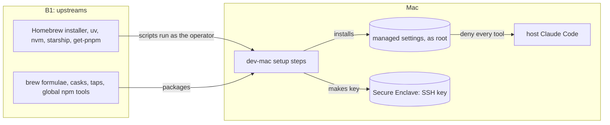

# Threat model: the dev-mac profile

**Kind**: feature
**Product model**: [product.md](product.md)
**Origin**: #109
**Last reviewed**: 2026-10-19

## Scope

This model covers what only the `dev-mac` profile installs and does on the Mac. The commands, the dotfiles, the sandbox kits, the GitHub side, and the sandboxes that the Mac runs are in the [product model](product.md). In the product model, "the host" is the Mac for this profile.

- **The `dev-mac` setup steps** (`profiles/dev-mac/`), and what they download.
- **Its `env.manifest`** and its doctor checks (`profiles/dev-mac/lib/doctor.sh`).
- **The Claude Code managed settings** that `30_tools` installs as root, and host Claude Code on the Mac.
- **The Keychain**, which holds the GitHub App key (product A1) on this profile.
- **The Secure Enclave SSH key** that `40_ssh_key` makes (part of product A4).

Out of scope:

- **Everything in the product model.** This model adds to it, and does not repeat it.
- **Physical access** to the Mac, as in the product model.

## Assets

This profile adds no asset to the product model. On the Mac, the Keychain holds A1, the Secure Enclave holds the SSH key of A4, and the Mac user account is A5.

## Actors

- **Host Claude Code**: on the Mac it only authenticates the sandboxes. The managed settings deny it every tool.
- **Adversary: compromised upstream** (as in the product model), for the installers and packages that this profile's setup steps download.

The other actors are in the product model.

## Entry points

- **Downloads during setup**:
  - The Homebrew installer, uv, nvm, starship, and `get-pnpm` (`profiles/dev-mac/00_preflight`, `15_languages`, `20_packages`).
  - Brew formulae, casks, and taps.
  - The global npm tools.
- **The managed settings file** (`profiles/dev-mac/lib/managed-settings.json`), which host Claude Code reads.

The other entry points are in the product model.

## Trust boundaries

This profile adds no boundary. Its threats cross product boundaries B1 (upstreams to a host), B5 (untrusted text to the agent), and B7 (key handling on the host).

## Data flows

## Threats

| ID  | STRIDE | Threat | Boundary | Likelihood | Impact | Status | Mitigation |
| --- | ------ | ------ | -------- | ---------- | ------ | ------ | ---------- |
| dev-mac-T1 | T | An installer script fetched with `curl \| sh` (Homebrew at `HEAD`, uv, starship, `get-pnpm`) is replaced, and runs as the operator. It can also ask for sudo. | B1 | low | high | accepted | None. It is fetched over HTTPS (I1). |
| dev-mac-T2 | T | A brew formula, cask, or tap, or a global npm tool (`sfw`, `socket`), is published with malicious code. None of them has a pinned version. | B1 | low | high | accepted | Package-manager digests. A 7-day minimum release age for pnpm. |
| dev-mac-T3 | E | Host Claude Code acts on the Mac with the operator's full access. | B5 | low | high | mitigated | dev-mac-I1 |
| dev-mac-T4 | I | The operator's SSH key is copied off the Mac. | B7 | low | high | mitigated | dev-mac-I2 |

STRIDE categories that have no threat above: the product model covers them for B1, B5, and B7. This profile adds no new crossing.

## Security invariants

| ID  | Invariant | Enforced in | Mitigates |
| --- | --------- | ----------- | --------- |
| dev-mac-I1 | `dev-mac` installs the managed settings as root with `deny: ["*"]`, `disableBypassPermissionsMode: "disable"`, and `allowManagedPermissionRulesOnly: true`. Doctor reports a missing or different installed copy. | `profiles/dev-mac/30_tools`, `profiles/dev-mac/lib/managed-settings.json`, `profiles/dev-mac/lib/doctor.sh` | T4 (product), dev-mac-T3 |
| dev-mac-I2 | The SSH key lives in the Secure Enclave with Touch ID protection. Doctor fails when the key is missing or has no Touch ID. | `profiles/dev-mac/40_ssh_key`, `profiles/dev-mac/lib/doctor.sh` | dev-mac-T4 |

## Accepted risks

| Threat | Reason | Accepted by | Date | Revisit when |
| ------ | ------ | ----------- | ---- | ------------ |
| dev-mac-T1, dev-mac-T2 | Every download comes over HTTPS from the vendor's own source. Package managers check signatures or digests, and Renovate and the 7-day release age apply where they can. On personal machines, pinning every installer costs more to maintain than it reduces the risk. | Dominick Triola | 2026-10-12 | An upstream has a security incident. |

## Assumptions

- The Mac has one user, and FileVault is on.
- The assumptions of the product model.
