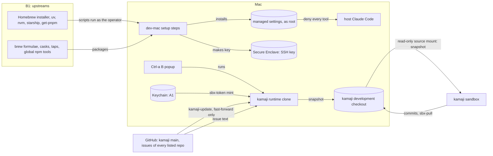

# Threat model: the dev-mac profile

**Kind**: feature
**Product model**: [product.md](product.md)
**Origin**: #109, #122
**Last reviewed**: 2026-10-26

## Scope

This model covers what only the `dev-mac` profile installs and does on the Mac. The commands, the dotfiles, the sandbox kits, the GitHub side, and the sandboxes that the Mac runs are in the [product model](product.md). In the product model, "the host" is the Mac for this profile.

- **The `dev-mac` setup steps** (`profiles/dev-mac/`), and what they download.
- **Its `env.manifest`** and its doctor checks (`profiles/dev-mac/lib/doctor.sh`).
- **The Claude Code managed settings** that `30_tools` installs as root, and host Claude Code on the Mac.
- **The Keychain**, which holds the GitHub App key (product A1) on this profile.
- **The Secure Enclave SSH key** that `40_ssh_key` makes (part of product A4).
- **The YubiKey secret store**: the `secrets` command (`commands/secrets/`), which only this profile installs, its library `lib/store.sh` that project scripts source, the store at `$SECRETS_HOME`, and the YubiKeys.
- **kamaji on the host**: the `kamaji` wrapper and `kamaji-update` (`env/.local/bin/`), the runtime clone at `~/.local/share/kamaji`, and the `Ctrl-a b` popup. kamaji's own code is in its repository; this model covers only how the Mac runs it.

Out of scope:

- **Everything in the product model.** This model adds to it, and does not repeat it.
- **Physical access** to the Mac, as in the product model.

## Assets

On the Mac, the Keychain holds A1, the Secure Enclave holds the SSH key of A4, and the Mac user account is A5. This profile adds these assets:

- **The kamaji snapshot** (`~/src/personal/kamaji/.kamaji/snapshot.json`): issue titles and bodies from every repository in kamaji's list, private ones too. The kamaji sandbox reads it, by design.
- **The secret store** (`$SECRETS_HOME`, default `~/.config/secrets`): one age file for each scope of a project, such as database URLs, storage tokens, and a GitHub token for operator scripts. Only the age identities on the YubiKeys decrypt it, as long as every `recipients.txt` (the shared one, and the optional one in each project folder) names only YubiKeys. The folder holds only ciphertext, and the names of the projects, scopes and keys.
- **The YubiKeys**: a main key and a backup, each with one age identity in a PIV slot (PIN once, touch always). The PIV PIN, the PUK, and the management key guard the slot.

## Actors

- **Host Claude Code**: on the Mac it only authenticates the sandboxes. The managed settings deny it every tool.
- **The kamaji board**: the operator opens it with `Ctrl-a b`. When the operator refreshes it, it mints tokens (A2) from A1 for each owner and writes the snapshot.
- **The kamaji sandbox**: an agent in a sandbox that works in a clone of the kamaji development checkout (product I4), and reads the snapshot through the read-only source mount.
- **Adversary: compromised upstream** (as in the product model), for the installers and packages that this profile's setup steps download.

The other actors are in the product model.

## Entry points

- **Downloads during setup**:
  - The Homebrew installer, uv, nvm, starship, and `get-pnpm` (`profiles/dev-mac/00_preflight`, `15_languages`, `20_packages`).
  - Brew formulae, casks, and taps.
  - The global npm tools.
- **The managed settings file** (`profiles/dev-mac/lib/managed-settings.json`), which host Claude Code reads.
- **kamaji's code and locked dependencies**, which `kamaji-update` takes from `main` on GitHub and installs with `pnpm install --frozen-lockfile`.
- **The kamaji development checkout**, which takes sandbox commits through `sbx-pull` before review (product T12).
- **`$SECRETS_HOME`**, which chooses the store that `secrets` and `lib/store.sh` read and write.
- **`~/.local/lib/secrets/lib/store.sh`**, which the operator's project scripts source. Its functions take a project and a scope from the caller, and do not check them as the `secrets` command does.
- **The secret values** that the operator types into `secrets set`, and that `secrets get` and `secrets run` give to the operator's scripts and tools.
- **Issue and PR text** from every repository in kamaji's list, which `kamaji refresh` and `kamaji board` read on the host.

The other entry points are in the product model.

## Trust boundaries

This profile adds no boundary. Its threats cross product boundaries B1 (upstreams to a host), B3 (sandbox to host, through the kamaji development checkout), B4 (host to sandbox, through the snapshot), B5 (untrusted text to the agent, and here to host processes too), and B7 (key handling on the host).

## Data flows

## Threats

| ID  | STRIDE | Threat | Boundary | Likelihood | Impact | Status | Mitigation |
| --- | ------ | ------ | -------- | ---------- | ------ | ------ | ---------- |
| dev-mac-T1 | T | An installer script fetched with `curl \| sh` (Homebrew at `HEAD`, uv, starship, `get-pnpm`) is replaced, and runs as the operator. It can also ask for sudo. | B1 | low | high | accepted | None. It is fetched over HTTPS (I1). |
| dev-mac-T2 | T | A brew formula, cask, or tap, or a global npm tool (`sfw`, `socket`), is published with malicious code. None of them has a pinned version. | B1 | low | high | accepted | Package-manager digests. A 7-day minimum release age for pnpm. |
| dev-mac-T3 | E | Host Claude Code acts on the Mac with the operator's full access. | B5 | low | high | mitigated | dev-mac-I1 |
| dev-mac-T4 | I | The operator's SSH key is copied off the Mac. | B7 | low | high | mitigated | dev-mac-I2 |
| dev-mac-T5 | E | A prompt injection makes the kamaji sandbox agent commit code, which `sbx-pull` brings into the development checkout. The popup runs it on the host, before review, with access to A1. | B3, B7 | medium | high | mitigated | dev-mac-I3 |
| dev-mac-T10 | E | The kamaji checkout's `.sbx.json` sets `"clone": false`, so the sandbox mounts it read and write, and writes `.git/config` (for example `core.fsmonitor`) or a hook that the host's git runs (product T10). | B3 | low | high | mitigated | dev-mac-I5 |
| dev-mac-T6 | T | `.kamaji` in the development checkout is a symlink, so the host writes the snapshot into another directory of the operator's. A clone-mode sandbox cannot make one (dev-mac-I5), but a commit that `sbx-pull` brings in could. | B3 | low | medium | mitigated | dev-mac-I4, dev-mac-I5. The check in I4 can lose a race with a process that changes the directory at the same time; only a sandbox in direct mode could be that process. |
| dev-mac-T7 | T | A GitHub user writes an issue on a listed public repository with terminal escape sequences, which `kamaji board` prints in the host terminal, or with instructions for the kamaji sandbox agent, which reads the snapshot. | B5 | medium | low | accepted | None in dotfiles. kamaji must remove control characters before it prints issue text. The agent in the sandbox has the limits of product B5. |
| dev-mac-T8 | I | kamaji prints a token from `sbx-token mint` in the terminal, where the tmux scrollback keeps it. | B7 | low | high | accepted | kamaji must never print a token, as product I8 requires of `sbx-token`. |
| dev-mac-T9 | T | A dependency in kamaji's lockfile is published with malicious code, and runs on the host with access to A1. | B1 | low | high | accepted | `--frozen-lockfile`, so only a lockfile that you reviewed in a PR installs. The 7-day minimum release age for pnpm. |
| dev-mac-T11 | I | The Mac is stolen with a YubiKey in it, so the thief has the store and a key that decrypts it. | B7 | low | high | mitigated | dev-mac-I6: the PIV PIN, which the bootstrap changes by hand. No check enforces the change. FileVault. |
| dev-mac-T12 | I | A process that runs as the operator (such as a malicious package) asks the YubiKey for a decrypt while an operation waits for a touch, so the operator's touch decrypts its request too. It can also read the environment of a `secrets run` command, or a value that `secrets get` pipes. | B7 | low | high | accepted | dev-mac-I6: each decrypt needs a touch, and decrypts one scope only. |
| dev-mac-T13 | I | A plaintext secret is written to disk: a temp file, a here-string or heredoc that bash puts in `/tmp`, an editor buffer, or the terminal scrollback. | B7 | low | high | mitigated | dev-mac-I7 |
| dev-mac-T14 | I | A scope is committed to a git repository and pushed, so a lost YubiKey decrypts it later, even after a rekey. | B7 | low | medium | mitigated | dev-mac-I8 |
| dev-mac-T15 | I | After a YubiKey is lost, a project's own `recipients.txt` still names it, so `secrets rekey` encrypts that project to the lost key again. Or the file names a recipient that is not a YubiKey, which needs no PIN and no touch. | B7 | low | high | mitigated | dev-mac-I8. The lost-key steps in `bootstrap.md` name each project file. |

STRIDE categories that have no threat above: the product model covers them for B1, B3, B4, B5, and B7.

## Security invariants

| ID  | Invariant | Enforced in | Mitigates |
| --- | --------- | ----------- | --------- |
| dev-mac-I1 | `dev-mac` installs the managed settings as root with `deny: ["*"]`, `disableBypassPermissionsMode: "disable"`, and `allowManagedPermissionRulesOnly: true`. Doctor reports a missing or different installed copy. | `profiles/dev-mac/30_tools`, `profiles/dev-mac/lib/managed-settings.json`, `profiles/dev-mac/lib/doctor.sh` | T4 (product), dev-mac-T3 |
| dev-mac-I2 | The SSH key lives in the Secure Enclave with Touch ID protection. Doctor fails when the key is missing or has no Touch ID. | `profiles/dev-mac/40_ssh_key`, `profiles/dev-mac/lib/doctor.sh` | dev-mac-T4 |
| dev-mac-I3 | The host runs kamaji only from the runtime clone. `kamaji-update` fast-forwards it to `main` from GitHub, never from the development checkout, and refuses when the clone has local changes or commits that are not on `main`. The `kamaji` wrapper runs only the runtime clone. Doctor fails when another `kamaji` comes first on PATH, and warns when the runtime clone has local changes. | `env/.local/bin/kamaji`, `env/.local/bin/kamaji-update`, `profiles/dev-mac/lib/doctor.sh` | dev-mac-T5 |
| dev-mac-I4 | The `kamaji` wrapper refuses to run when `.kamaji` in the development checkout is a symlink. It runs kamaji in the runtime clone's directory, so the directory of the pane that opens the popup does not change what kamaji reads. | `env/.local/bin/kamaji` | dev-mac-T5, dev-mac-T6 |
| dev-mac-I5 | Doctor fails when the kamaji checkout's `.sbx.json` sets `"clone": false`, so the kamaji sandbox keeps product I4. | `profiles/dev-mac/lib/doctor.sh` | dev-mac-T6, dev-mac-T10 |
| dev-mac-I6 | `secrets init` makes an age slot only with `--pin-policy once --touch-policy always`. The bootstrap changes the default PIV PIN, PUK, and management key, and keeps the backup YubiKey in another place. Doctor warns when the store has fewer than two recipients. | `commands/secrets/lib/init`, `profiles/dev-mac/bootstrap.md`, `profiles/dev-mac/lib/doctor.sh` | dev-mac-T11, dev-mac-T12 |
| dev-mac-I7 | `secrets` and `lib/store.sh` move a plaintext only through pipes, command substitutions, and parameter expansions, never a file, a here-string or a heredoc. `set` reads values without echo. `keys` and `set` never print a value, and `get` refuses to print to a terminal. age writes the new ciphertext to a temp file, which replaces the scope only after age succeeds. | `commands/secrets/` | dev-mac-T13 |
| dev-mac-I8 | `secrets` makes every file with umask 077. Doctor fails when `$SECRETS_HOME` is not mode 700, when a file in it can be read by the group or others, or when a scope is inside a git working tree. Doctor reports the recipient count of the shared `recipients.txt` and of each project's own file, and warns at fewer than two. | `commands/secrets/secrets`, `profiles/dev-mac/lib/doctor.sh` | dev-mac-T13, dev-mac-T14, dev-mac-T15 |

## Accepted risks

| Threat | Reason | Accepted by | Date | Revisit when |
| ------ | ------ | ----------- | ---- | ------------ |
| dev-mac-T7, dev-mac-T8 | kamaji owns these mitigations, in its own repository. Modern terminals block the dangerous escape sequences, as for product T13. | Dominick Triola | 2026-10-23 | kamaji prints issue text or logs its requests. |
| dev-mac-T9 | The same reason as dev-mac-T2, and a lockfile change shows in the PR diff. | Dominick Triola | 2026-10-23 | kamaji adds a dependency with an install script. |
| dev-mac-T1, dev-mac-T2 | Every download comes over HTTPS from the vendor's own source. Package managers check signatures or digests, and Renovate and the 7-day release age apply where they can. On personal machines, pinning every installer costs more to maintain than it reduces the risk. | Dominick Triola | 2026-10-12 | An upstream has a security incident. |
| dev-mac-T12 | A process that runs as the operator can already read the operator's files and the environment of the operator's processes. The YubiKey makes it wait for an operation, and a touch decrypts one scope only. | Dominick Triola | 2026-10-29 | A scope holds a secret that is worth more than the operator's own access, or a YubiKey with a touch display (one request for each touch) is available. |

## Assumptions

- The Mac has one user, and FileVault is on.
- The assumptions of the product model.
